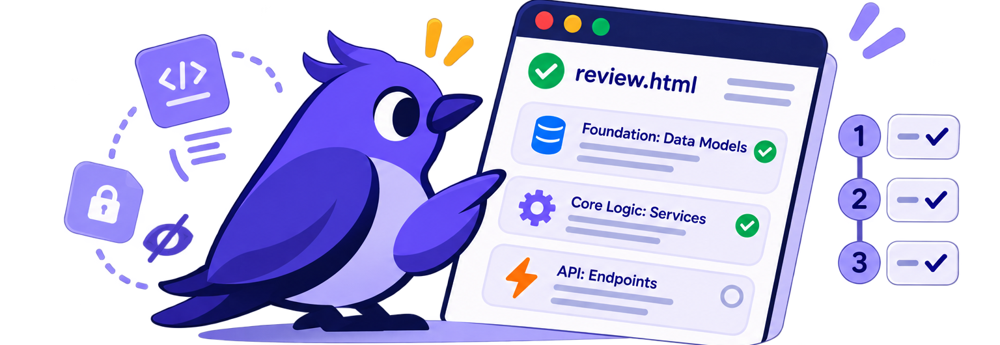

<p align="center">
  
</p>

<h1 align="center">Bowi</h1>

<p align="center"><strong>Bowi</strong> (short for <em>bowerbird</em>) turns a pull request into a guided review: related changes grouped together,<br>foundations before the code that uses them, noise collapsed, and every group explained with evidence. The result is one self-contained <code>review.html</code>.</p>

<p align="center">
  <a href="LICENSE"></a>
  <a href="https://www.npmjs.com/package/@bowi/cli"></a>
  <a href="https://nodejs.org"></a>
</p>


## Why Bowi

A pull request tells a story, but review tools present it differently:

- You see a list of files sorted alphabetically.
- You open the controller before the service it calls.
- You see the tests before the code they test.
- A 2,000-line lockfile sits in the middle of it all.

That work is where reviews go wrong. Reviewers get tired, skim, and approve what they did not really read, or they leave a big pull request waiting because it is hard to start.

Bowi does that sorting for you, so your attention goes to the change itself. It lays the pull request out the way its author would walk you through it: one topic at a time, foundations first, with the noise set aside.

## What Bowi does

Give Bowi a branch or a GitHub pull request, and it:

1. **Sets the noise aside.** Generated files, lockfiles, formatting-only edits and code that was only moved are collapsed, never hidden, so they do not compete with real changes.
2. **Groups related changes.** It follows how the code connects (calls, types, imports, tests, shared names, commits) and puts changes that belong to one idea into one group, even when they are spread across many files.
3. **Orders them for reading.** Inside each group, steps go from foundations to the code that uses them: data shapes, then services, then API, then tests.
4. **Explains each group.** Every group says why its changes belong together, with the evidence. Hints point at things worth a second look, such as a new route or a newly added guard, and unchanged code that calls a changed function is listed so you can check what else might break.
5. **Writes one page.** The result is a single `review.html` that works offline and makes no requests: open it, step through it, mark steps reviewed.

Bowi only reads your code. It never builds, installs or runs anything from the repository it reviews. With `--ai`, it can also have an AI write the titles and a summary (see [AI enrichment](#ai-enrichment-optional));

## Installation

You need:

- **Node 22.12 or newer** (`node --version`), which comes with npm. Get it from [nodejs.org](https://nodejs.org) or a version manager (nvm, fnm, Homebrew).
- **git 2.31 or newer** (`git --version`).
- **macOS, Linux or Windows**

Install the `bowi` command:

```bash
npm install -g @bowi/cli      # or: pnpm add -g @bowi/cli, bun add -g @bowi/cli
bowi --version
```

Installing runs nothing (Bowi has no install scripts), and Bowi itself connects only to GitHub, for pull request URLs, and to the AI provider when you turn AI on.

## Usage

In any git repository, on the branch you want to review:

```bash
bowi --local                                       # this branch against main (or origin/HEAD), uncommitted work included
bowi --local --base develop                        # against another branch
bowi https://github.com/<owner>/<repo>/pull/<n>    # a GitHub pull request; no clone of that repository needed
```

Both write `review-plan.json` and `review.html` to `.bowi/<repo>-<pr-or-branch>/` and open the page. Private GitHub repositories need `gh auth login` ([GitHub CLI](https://cli.github.com)) or a `GITHUB_TOKEN` environment variable; public repositories and `--local` need nothing. Fetched code is cached (`bowi cache clear` removes it).

In the report, `j` / `k` move to the next and previous step and `r` marks the current step reviewed.

To try Bowi on a small sample first, build the demo repository (a NestJS backend with an "email verification" branch) from inside a clone of this repository (see [Development](#development)):

```bash
bun run fixture email-verification ~/bowi-demo
cd ~/bowi-demo && bowi --local
```

### AI enrichment (optional)

With `--ai`, Bowi asks an AI model to name each group of code changes, explain in 1–3 sentences what it does, and write an overview of the whole change (shown in the Description tab). Everything the AI wrote is marked "AI" in the report, together with the model that wrote it. AI is off by default; without it, Bowi writes its own titles and descriptions.

What is sent: for each group, its changed lines with a few lines around them, the functions and classes they touch and why Bowi grouped them; and the pull request's title, description and commit messages (first lines only). Never sent: generated files, formatting-only changes, moved code or whole files. Bowi checks every answer against the expected format before using it and caches it, so running again on the same changes makes no new calls. If a call fails or times out, that group keeps Bowi's own title.

The AI is reached through a provider, chosen with `ai.provider` in the config:

| Provider      | Status    | What it uses                                                                                     |
| ------------- | --------- | ------------------------------------------------------------------------------------------------ |
| `claude-code` | Available | Your local [Claude Code](https://claude.com/claude-code) and its login (no API key for Bowi)     |
| Others        | Planned   | More providers, such as AI provider APIs with your own key and local models, will be added later |

#### Set up Claude Code

1. Install Claude Code: `curl -fsSL https://claude.ai/install.sh | bash` (or `npm install -g @anthropic-ai/claude-code`; see the [setup guide](https://docs.claude.com/en/docs/claude-code/setup)). On Windows, use the native installer in PowerShell, `irm https://claude.ai/install.ps1 | iex`: Bowi cannot run the npm package's `claude.cmd` there.
2. Run `claude` once in a terminal and log in (a Claude subscription or an Anthropic Console account), then quit it. `claude --version` should work in the terminal you run Bowi from.
3. Run Bowi with `--ai`:

```bash
bowi --local --ai
```

To pick the model and effort, or to turn AI on without `--ai`, put an `ai` section in your config file:

```json
{
  "ai": { "enabled": true, "provider": "claude-code", "model": "sonnet", "effort": "low" }
}
```

- `model` is a Claude Code model name or alias (`sonnet`, `opus`, `haiku`; empty: Claude Code's default).
- `effort` is `low`, `medium`, `high`, `xhigh` or `max` (empty: Claude Code's default); lower is faster.
- For `--local`, the file can be the repository's `.bowi.json`. For a pull request, the repository's own `.bowi.json` cannot turn AI on (otherwise whoever opened the pull request could make Bowi send code using your account), so keep your settings in a file of your own and pass it: `bowi <pr-url> --config ~/bowi.json`. All AI keys are listed under [Configuration](#configuration).

Bowi runs Claude Code locked down: in an empty temporary folder, with no tools and no MCP servers, and without your CLAUDE.md, hooks or plugins. Your own Claude Code setup does not see Bowi's requests and cannot change the answers. Calls use your Claude Code login and count toward its usage limits.

## What Bowi understands

Best supported today: **TypeScript and JavaScript projects, especially NestJS backends**, where every feature applies. Other TypeScript/JavaScript projects (React, Next.js, Express, libraries) get everything except framework-specific layers, links and hints. Files in other languages are still shown, grouped and never dropped, but as plain text.

### Languages

| Language                                              | Files                                                 | What Bowi does with it                                                                                                                                                                                                                            |
| ----------------------------------------------------- | ----------------------------------------------------- | ------------------------------------------------------------------------------------------------------------------------------------------------------------------------------------------------------------------------------------------------- |
| TypeScript, TSX, JavaScript, JSX                      | `.ts` `.mts` `.cts` `.tsx` `.js` `.mjs` `.cjs` `.jsx` | Full support: changes mapped to functions, methods, classes, interfaces, types, top-level constants and test blocks; links from calls, types, imports and tests; formatting-only changes and moved code detected; unchanged callers listed; hints |
| JSON                                                  | `.json`                                               | Keys two levels deep (e.g. `dependencies.nodemailer`); `package-lock.json` summarized (new, removed and major-version dependencies)                                                                                                               |
| YAML                                                  | `.yaml` `.yml`                                        | Keys two levels deep (e.g. `jobs.build`)                                                                                                                                                                                                          |
| Markdown                                              | `.md` `.markdown`                                     | Sections by heading (e.g. `Authentication.Email verification`); re-wrapped text counts as formatting; docs join the code they mention                                                                                                             |
| Everything else (SQL, Python, Go, Java, Ruby, CSS, …) |                                                       | Text only: diffed and grouped by shared names and folders, with syntax highlighting when available; no symbols or move detection. SQL support is planned                                                                                          |

Generated files are collapsed as noise, never removed: lockfiles (npm, Yarn, pnpm, Bun), `dist/`, `*.min.js`, `*.min.css`, `*.snap`, `*.gen.ts`, `*.generated.*`, files whose header says `@generated` or `DO NOT EDIT`, files marked `linguist-generated` in `.gitattributes`, and your `generated` globs. Only npm lockfiles get a dependency summary.

### Frameworks

| Framework                         | How it is detected                                     | What Bowi adds                                                                                                                                                                                                                                                                                                                                                                                                                        |
| --------------------------------- | ------------------------------------------------------ | ------------------------------------------------------------------------------------------------------------------------------------------------------------------------------------------------------------------------------------------------------------------------------------------------------------------------------------------------------------------------------------------------------------------------------------- |
| NestJS                            | `@nestjs/core` or `@nestjs/common` in a `package.json` | Layers from decorators (table below); links from code that queues a job or emits an event to its handler (`queue.add('welcome')` → `@Process('welcome')`, `emit('user.created')` → `@OnEvent('user.created')`), from a class to a service it newly injects, and from a migration to the entity columns it adds; hints for new or changed routes (`New route: GET /auth/verify-email`) and for added `@UseGuards`, `@Roles`, `@Public` |
| Express, Fastify, Koa and similar | Always on                                              | Hints for new or changed routes written as `router.post('/users', …)`; layers from folders                                                                                                                                                                                                                                                                                                                                            |
| Others (React, Next.js, Vue, …)   |                                                        | Layers from folders and file names only                                                                                                                                                                                                                                                                                                                                                                                               |

### Layers

Each group is split into steps by layer, and steps are read in dependency order: code before the steps that call it. When two steps do not depend on each other, the order is data shape, helpers, domain, services, API, UI, other code, configuration, tests, docs.

If a folder misleads Bowi (e.g. a service under `common/` that is not a NestJS class), set its layer in `.bowi.json`.

<details>
<summary>How Bowi picks a file's layer</summary>

A file's layer comes from your `.bowi.json` `layers` first, then from NestJS decorators, then from its path (the first matching row in the order test, docs, config, schema, data, domain, service, API, helpers, UI).

| Step          | Layer     | Path rules                                                                                                                                                                                      | NestJS decorators                                                                                                      |
| ------------- | --------- | ----------------------------------------------------------------------------------------------------------------------------------------------------------------------------------------------- | ---------------------------------------------------------------------------------------------------------------------- |
| Data shape    | `schema`  | `migrations/`, `schema/`, `schemas/`, `prisma/`; `.sql` `.prisma` `.graphql` `.gql` `.proto`                                                                                                    | Classes implementing `MigrationInterface` (TypeORM)                                                                    |
| Data shape    | `data`    | `entities/`, `models/`, `repositories/`, `dto/`, `interfaces/`, `types/`; `*.entity.ts`, `*.model.ts`, `*.repository.ts`, `*.dto.ts`, `*.schema.ts`, `*.interface.ts`, `*.types.ts`, `types.ts` | `@Entity`, `@Schema`, `@ObjectType`, `@InputType`, `@ArgsType`; DTO classes with validation decorators (`@IsEmail`, …) |
| Helpers       | `util`    | `helpers/`, `utils/`, `lib/`, `common/`, `shared/`; `helpers.ts`, `utils.ts`, `*.helper.ts`, `*.util.ts`                                                                                        |                                                                                                                        |
| Domain        | `domain`  | `domain/`                                                                                                                                                                                       |                                                                                                                        |
| Services      | `service` | `services/`, `jobs/`, `workers/`, `processors/`, `queues/`; `*.service.ts`, `*.processor.ts`, `*.worker.ts`, `*.job.ts`                                                                         | `@Injectable`, `@Processor`                                                                                            |
| API           | `api`     | `controllers/`, `routes/`, `handlers/`, `resolvers/`, `api/`, `endpoints/`; `*.controller.ts`, `*.resolver.ts`, `*.route(s).ts`, `*.handler.ts`, `*.gateway.ts`                                 | `@Controller`, `@Resolver`, `@WebSocketGateway`, `@Catch`; `@Injectable` guards, interceptors, pipes and middleware    |
| UI            | `ui`      | `components/`, `pages/`, `views/`, `app/`, `screens/`, `layouts/`; `.tsx` `.jsx` `.vue` `.svelte` `.css` `.scss` `.html`                                                                        |                                                                                                                        |
| Other code    | `unknown` | Anything not matched                                                                                                                                                                            |                                                                                                                        |
| Configuration | `config`  | `package.json`, `tsconfig*.json`, `*.config.*`, `.*rc` files, `.env*`, `Dockerfile`, `docker-compose*`, `Makefile`, `.github/`, `.yml` `.yaml` `.toml` `.ini`, lockfiles                        | `@Module`                                                                                                              |
| Tests         | `test`    | `test/`, `tests/`, `__tests__/`, `spec/`, `e2e/`; `*.spec.ts`, `*.test.ts`, `*.e2e-spec.ts` (and `.js`)                                                                                         | Never: test files keep their path layer                                                                                |
| Docs          | `docs`    | `docs/`; `.md` `.mdx` `.rst` `.adoc`; `README`, `CHANGELOG`, `CONTRIBUTING`, `LICENSE`                                                                                                          |                                                                                                                        |

</details>

## Configuration

Bowi reads `.bowi.json` from the repository root (for a pull request: the file as it is on the base branch, so a PR cannot change how it is presented), or the file given with `--config <path>`. Every key is optional; unknown keys are reported and ignored.

```json
{
  "base": "main",
  "generated": ["src/graphql/generated/**", "**/*.pb.ts"],
  "layers": { "schema": ["db/migrations/**"], "api": ["src/**/routes/**"] },
  "grouping": { "edgeThreshold": 0.5, "moveSimilarity": 0.8, "maxGroupShare": 0.4 },
  "outsideRefs": { "maxPerSymbol": 5 },
  "order": "dependency",
  "ai": { "enabled": false, "provider": "claude-code", "model": "sonnet", "effort": "low" }
}
```

| Key                        | Meaning                                                                                                                                                 |
| -------------------------- | ------------------------------------------------------------------------------------------------------------------------------------------------------- |
| `base`                     | Base branch for `--local` (default `origin/HEAD`, else `main`, else `master`). `--base` wins                                                            |
| `generated`                | Extra globs for generated files, shown collapsed as noise                                                                                               |
| `layers`                   | Globs per layer (`schema`, `data`, `util`, `domain`, `service`, `api`, `ui`, `config`, `test`, `docs`), checked before framework plugins and path rules |
| `grouping.edgeThreshold`   | Minimum link weight (0–1) that puts two changes in one group                                                                                            |
| `grouping.moveSimilarity`  | How similar (0–1) moved code must stay to count as a move                                                                                               |
| `grouping.maxGroupShare`   | Share of all changes (0–1] above which a large group is split                                                                                           |
| `outsideRefs.maxPerSymbol` | Unchanged callers listed per changed symbol (0–50); `0` turns the search off                                                                            |
| `order`                    | Reading order the report opens with: `dependency` or `tests-first`. `--order` wins                                                                      |
| `ai.enabled`               | AI enrichment (see above). `--ai` / `--no-ai` win. Ignored in a pull request's own `.bowi.json`: only you can turn it on                                |
| `ai.provider`              | `claude-code`, the only available provider so far                                                                                                       |
| `ai.model`                 | Model for the provider, e.g. `sonnet` for Claude Code (empty: the provider's default)                                                                   |
| `ai.effort`                | `low`, `medium`, `high`, `xhigh` or `max` (empty: the provider's default)                                                                               |
| `ai.concurrency`           | Calls to the AI at once (1–10, default 3)                                                                                                               |
| `ai.timeoutSeconds`        | Time per call before that group keeps Bowi's own title (default 120)                                                                                    |

## Development

Running from a clone needs **Node 22.18 or newer**, which runs the TypeScript sources directly (on 22.12–22.17, add `--experimental-strip-types` after `node`), and **Bun** (`curl -fsSL https://bun.sh/install | bash`, `brew install oven-sh/bun/bun`, or on Windows `npm install -g bun@1.4.4`).

```bash
git clone https://github.com/thaichihien/bowi.git
cd bowi
bun install
bun run build:ui       # builds the report page template; Bowi cannot write review.html without it
node packages/cli/src/bin.ts --help
```

To use the clone as your `bowi` command, add an alias inside the clone (use `~/.bashrc` for bash): `echo "alias bowi='node $PWD/packages/cli/src/bin.ts'" >> ~/.zshrc`. Update it with `git pull && bun install && bun run build:ui`.

```bash
bun run check          # typecheck, lint, format check, tests
bun run fixture email-verification /tmp/ev   # build a fixture repo to play with
```

| Script                                      | What it does                                                                                                                                       |
| ------------------------------------------- | -------------------------------------------------------------------------------------------------------------------------------------------------- |
| `bun run test`                              | vitest                                                                                                                                             |
| `bun run typecheck`                         | tsc over sources, tests and fixtures                                                                                                               |
| `bun run lint` / `bun run format`           | ESLint / Prettier                                                                                                                                  |
| `bun run build`                             | compile every package to `dist/`                                                                                                                   |
| `bun run show-plan <plan-or-dir> [hunk-id]` | print a `review-plan.json` readably (dev tool)                                                                                                     |
| `BOWI_REPORT=<review.html> bun run dev:ui`  | the report page with hot reload, for working on its look: edits to `packages/render-html/ui/` show at once; the plan comes from an existing report |
| `bun run bench`                             | grouping benchmark: Bowi vs folder grouping on real commits; `bun run bench explain <case>` details one case                                       |
| `bun run build:package`                     | the npm package `@bowi/cli` in `build/npm/`: every `@bowi/*` package bundled, grammars, queries and the page template                              |
| `bun run smoke`                             | builds the package, installs it with npm into an empty folder and checks that it produces the same plan as the sources                             |

## License

MIT
